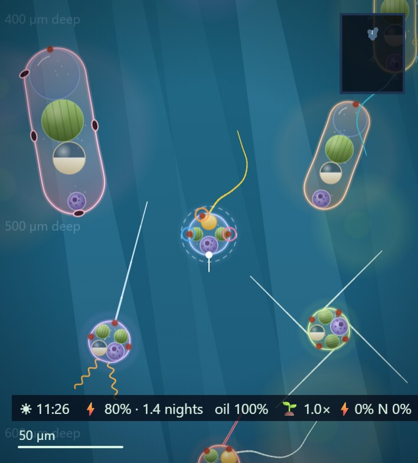
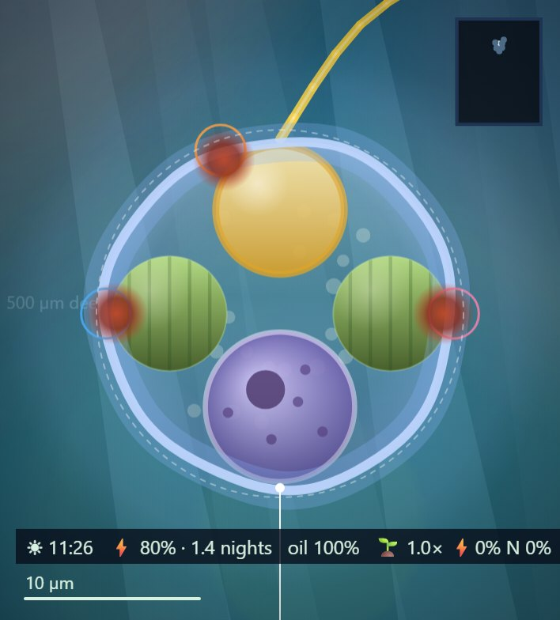
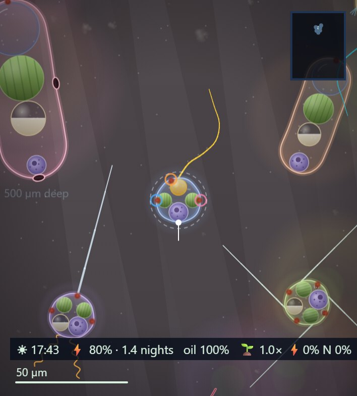
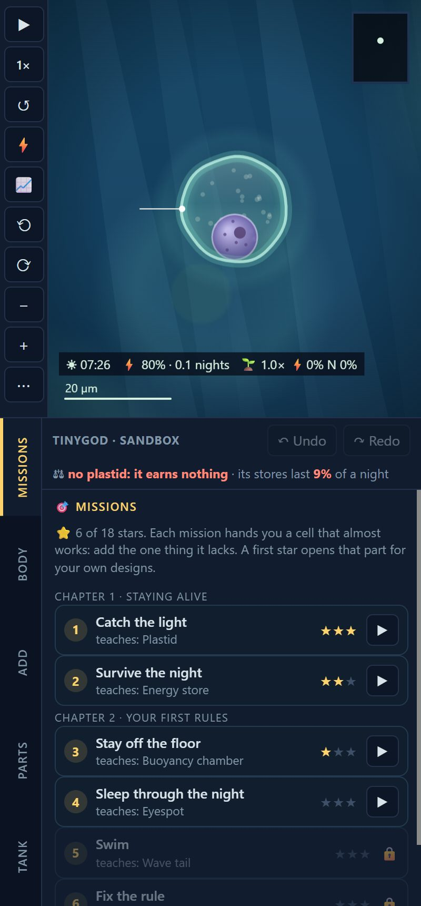
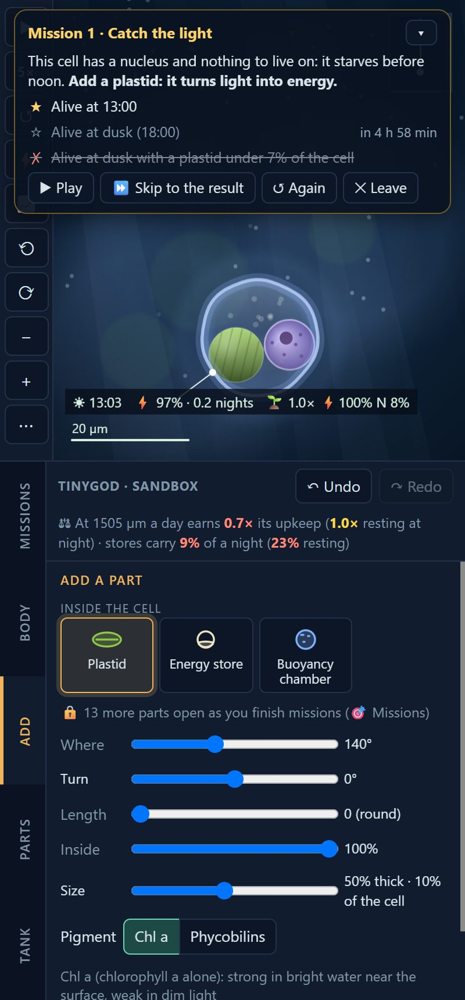
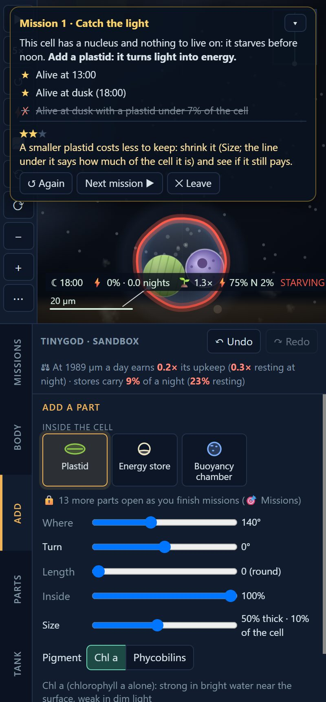
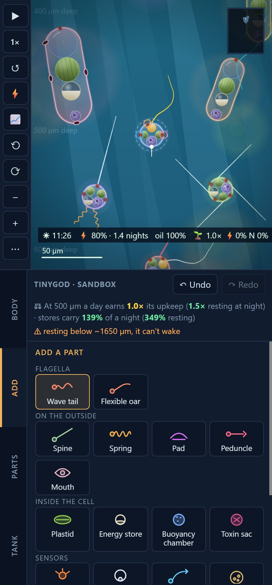
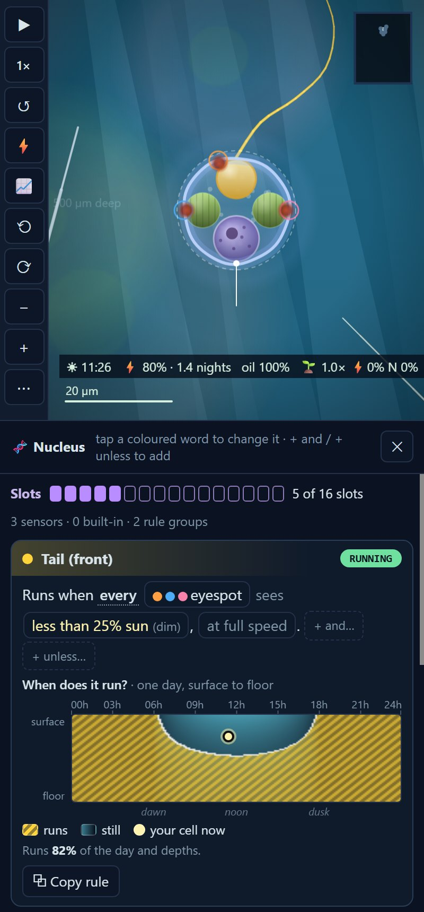
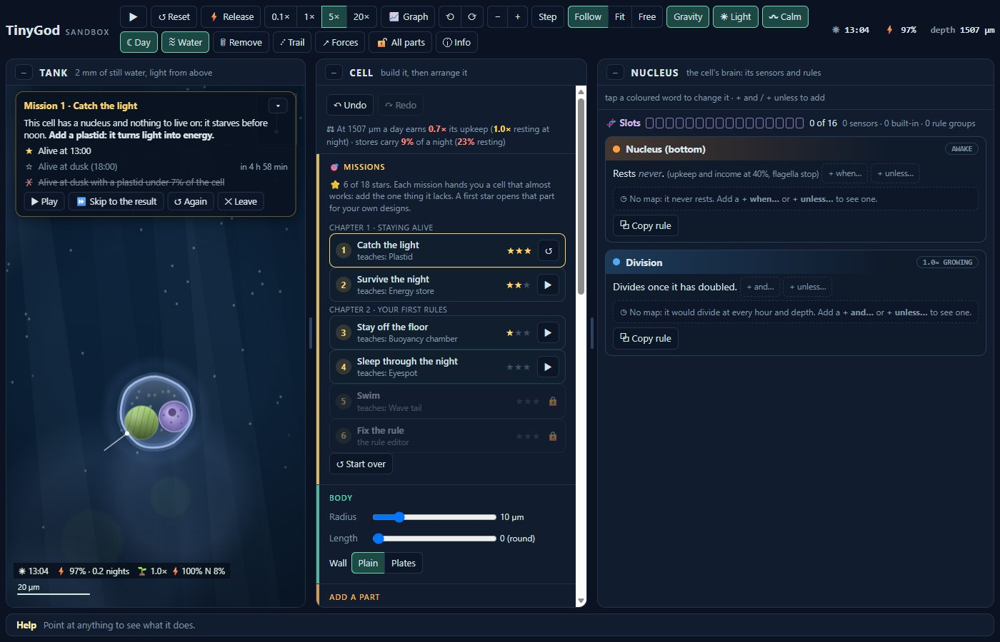

# TinyGod

**Design your own phytoplankton species and watch it fight for a living in a sunlit water column.**

▶ **Play it in your browser: https://vitorhugo1992.github.io/tinygod/**
(It works on a phone, and keeps working offline once opened.)

<p align="center">
  
  
  
</p>

---

## What it is

TinyGod is a game about the tiny drifting plants of the sea. You don't pick a ready-made creature: you **build one from parts**,
decide **how it behaves**, then drop it into a tank of water and see whether it lives, grows and spreads, or sinks and starves.

Everything a cell does comes from how you built it. A float in the wrong place tips it over. A tail with no light sensor
swims into the dark. A store too small runs out at 3 in the morning. When it dies, the game tells you why and where.

## Start with the missions

New to it? The **🎯 Missions** tab teaches the tools one at a time. Each mission hands you a cell that *almost* works:
it starves before noon, sinks to the floor, or swims the wrong way. You add the one thing it lacks, press ▶, and the
game judges it live (or ⏩ skip straight to the result). Three stars each: the goal, the goal done leaner, the goal done
harder. When it fails, the verdict says when and where it died and gives a hint.

Parts open as you earn them: a mission's first star unlocks the part it taught for your own designs. (🔓 All parts, under
⋯ More, opens everything at once.)

<p align="center">
  
  
  
</p>

**Chapter 1, staying alive:** catch the light (a plastid), survive the night (an energy store).
**Chapter 2, your first rules:** stay off the floor (a buoyancy chamber), sleep through the night (resting with an
eyespot), swim (a tail that pulls), fix a broken rule. More chapters (growing, other species, the tank) are coming.

## Build a cell



- **Body:** round or rod-shaped, any size, a plain wall or armoured plates.
- **Inside:** plastids that turn sunlight into energy, starch and oil stores for the night, a buoyancy chamber to float or
  sink, a nucleus (the brain: every sensor and rule takes one of its slots), a toxin sac that bursts or leaks into the
  water, a nitroplast that turns energy into nitrogen.
- **Outside:** whip-like tails and oars to swim, spring legs to jump, spines, sticky pads that join cells into chains.
- **Senses:** eyespots for light, a gravity sensor, feelers for touch, nearby cells or moving water, a nutrient sensor.
- **Hunting:** a feeding tube that drains other cells (and steals their plastids), a mouth that swallows smaller ones
  whole, a harpoon fired blind, a tether (a harpoon on a line that holds and reels in). Armour plates make a tube
  drill before it can feed.

Then you give the parts **rules**, written as plain sentences:
*"The tail runs when every eyespot sees less than 25% sun, unless energy is low."*
A small map under each rule shows at which hours and depths it would act.

<p align="center"></p>

## The tank

A column of water 2 mm deep, with a day and night that pass in ten minutes:

- **Light** from above, fading with depth: too little and a cell starves, too much and its plastids are damaged.
  A bloom shades the water under it, so a crowd brakes itself.
- **Nitrogen** is rich deep down and poor near the surface, in patches that wander across the tank, so a cell needs
  both the light above and the food below (or a nitroplast, at a price). The dead rot where they die, and sloppy
  hunters spill what they don't keep.
- **Moving water**: slow currents turn through the tank, stronger at night, and now and then the bottom stirs up.
- **Growth, division and death**: well-fed cells grow and split; starving ones die and sink.
- **Other species**: several designs share the tank and compete, hunt each other, or band together.

It is drawn like a living microscope: see-through cells with streaming insides, shafts of sunlight, drifting marine snow.

On a computer the game spreads into three windows (tank, cell, nucleus); on a phone the tabs run down the side.

<p align="center"></p>

## Species from AIs

Can an AI design a species that wins? The [entry page](https://vitorhugo1992.github.io/tinygod/enter/) gives any chat AI
(ChatGPT, Gemini, Claude…) the same rules, [docs/DESIGN-A-SPECIES.md](docs/DESIGN-A-SPECIES.md), checks the design it
answers with, and lets you watch it in the game. Entries meet in a tournament: one tank, random starting spots, several
runs, scored by how much their living biomass grew.

## Under the hood

The cells really swim, sink and turn by the physics of very small things in water (no momentum: they stop the moment they
stop pushing). Light, energy, nutrients and growth follow simple rules shaped by real phytoplankton biology, with the
numbers tuned for play. The same tank and the same start always play out the same way.

Plain JavaScript and the HTML canvas: no framework, no build step.

```
sim/        the simulation (no browser code; also runs in Node)
sandbox/    the game page: drawing, the build panel, the rules
designs/    species to try (in the game: 📥 From Claude)
design/     mock-ups of ideas
tools/      tests, a local server, contests between species
```

**Run it yourself:** `node tools/serve.mjs`, then open http://localhost:5180/sandbox/
**Test the physics:** `node tools/check.mjs` · **the missions:** `node tools/missions-check.mjs`
**A contest:** `node tools/contest.mjs bathyscapha,noctilla,gula 10` (scores: mean biomass growth over the run, cells, biomass share, kills)

## Status

An early, playable sandbox that changes often. Missions cover the first two chapters; next come more chapters and
balancing the species against each other (nitrogen fixers are strong right now).

Built with [Claude](https://claude.com/claude-code).
